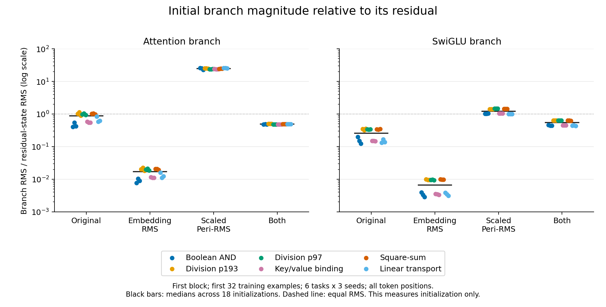

# Initial residual scales

This diagnostic measures the original model, embedding RMS alone, scaled Peri-RMS
alone, and their existing combination on the six fixed screen tasks and seeds
0/1/2. It is declared after the embedding-only screen and while the Peri screen
is running. It is descriptive and does not change candidate settings or selection.

Use the first 32 stored training examples, with the actual task adapter and
original initialized parameters. Measure embedding RMS and the first block's
attention and feed-forward residual contributions, including the actual guarded
prefix sharing. Include every token position, including zero attention outputs.
Compare each branch's RMS with the state to which it is added. No optimizer,
held-out scoring, trained checkpoint or new learning run is involved.

The [plan](plan.json) fixes the cohort, measurements and source hashes before
execution. The hook observations must reconstruct both actual residual additions
exactly; instrumented and uninstrumented logits must match exactly. All four
models must retain equal original parameter tensors, ordering, buffers and RNG,
and tied embedding/readout identity. These checks validate the diagnostic path;
the separate architecture study already validates the model equations.

All **72/72 measurements** completed with finite outputs and exact hook,
residual-addition, tensor, tying and RNG checks. The [complete record](results/initial-scales.json)
contains all 18 task/seed observations for each arm, input/state/activation hashes,
per-position ratios and all six three-seed task medians. The captured
[output](results/audit-output.txt) matches every recorded row.

The ranges below include all 18 initializations per arm. Each ratio divides the
applied branch RMS by the RMS of the state to which that branch is added.

| Arm | Embedding RMS | Attention / residual RMS | Feed-forward / residual RMS |
|---|---:|---:|---:|
| Original | 0.01868–0.02122 | 0.4067–1.1394 | 0.1237–0.3543 |
| Embedding RMS alone | 0.99983–0.99986 | 0.00760–0.02252 | 0.00284–0.00992 |
| Scaled Peri-RMS alone | 0.01868–0.02122 | 22.5508–26.0577 | 0.9998–1.4844 |
| Both | 0.99983–0.99986 | 0.4760–0.5001 | 0.4356–0.6422 |



The [SVG figure](results/initial-scales.svg) includes all observations on a log
scale. Colors identify tasks; black bars show medians across the 18 initialized
models in each arm. [Figure metadata](results/figure.json) pins the data, plotting
source and rendered files. It uses the existing system Matplotlib installation
and does not modify the training environment.

Embedding RMS alone makes the skip state much larger relative to the initial
branches. Scaled Peri-RMS alone makes the first attention branch much larger
relative to the original embedding. Their combination changes that balance again.
This is a measured architectural interaction at initialization; separate learning
measurements are needed to determine its practical effect. None of these ratios
is a selected target or a new hyperparameter.

Initial branch magnitude is not a convergence guarantee or an explanation of
long-suite failures. Forward CPU FP32 observations, reduced in FP64, are numerical
measurements rather than real-arithmetic or GPU trajectory guarantees.

```bash
OMP_NUM_THREADS=1 MKL_NUM_THREADS=1 PYTHONPATH=. .venv/bin/python -m research.core_initial_scale.audit
MPLCONFIGDIR=/tmp/gpt-core-initial-scale-mpl /usr/bin/python3 research/core_initial_scale/plot.py
```
