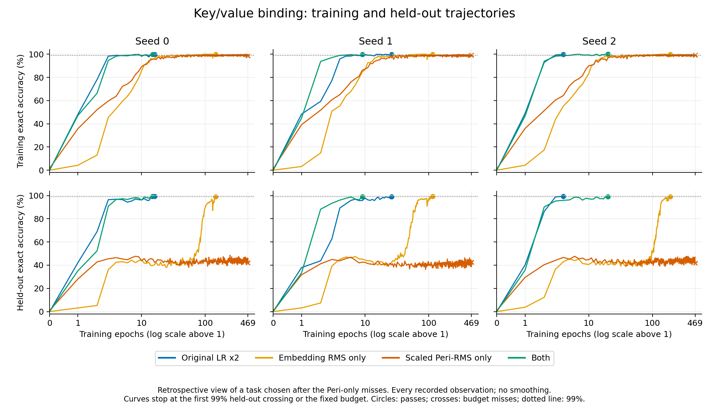

# Single additions to the original model

The [plan](plan.json) follows the requested return to the old architecture.
The control is the completed original-model AdamW LR×2 run. Three candidates
individually add embedding RMS, scaled Peri-RMS, or SSMax with the original gain.
All retain Q/K RMS, centered XSA, SwiGLU, fixed RoPE and tied weights. Original
parameters, initialization, data, seeds, budgets and scoring remain fixed.

This benchmark was selected from the original model's successful seed-1 runs.
The historical long subset passed 10/10 with that seed; the later three-seed
baseline passed 29/30. These comparisons measure preservation and acceleration
of known abilities. They do not establish superiority on an independently
selected task population or suitability as a universal model.

| Arm | Embedding | Residual branches | Attention coefficient |
|---|---|---|---|
| Existing LR×2 control | Original | Original | Original fixed gain |
| Embedding RMS | Add RMS | Original | Original fixed gain |
| Scaled Peri-RMS | Original | Output RMS, then `1/sqrt(2L)` | Original fixed gain |
| SSMax | Original | Original | `log(visible keys)` times original fixed gain |

Each new arm completes an 18-cell screen against the old LR×2 control; all pass
and at least three of six paired task medians must improve to advance. Every
promoted arm then completes all 75 short cells. Compare every outcome with the
old control, baseline, inverse-width incumbent and applicable combined-stack
controls. The earlier unscaled Peri-RMS negative remains recorded.

The global short-suite incumbent remains inverse-width at 16.2660501255
geometric-mean epochs unless a new complete candidate improves it. Only a newly
frozen shared winner gets one reused long diagnostic. An improvement over the old
control alone does not silently change the selection criterion. No long outcomes
choose model settings, rates, promotion or the short winner.

The guarantees differ across these models. Embedding RMS bounds the initial
state only; scaled Peri-RMS without it bounds growth relative to the original
embedding norm. SSMax retains the original gain, with its corresponding score
bound. None of these properties proves successful optimization or explains the
previous long failures by itself.

The [adjacent-RMS supplement](../rms_composition_guarantees/README.md) checks the
embedding-RMS followed by first input RMS. Two equal-epsilon real maps have
sensitivity bound `1/epsilon`, reached along unit-RMS directions at zero, whereas
one map has coefficient `1/sqrt(epsilon)`. Five Lean statements and 32 local CPU
value/gradient checks pass. This concerns the adjacent maps, not a whole-model
bound or a demonstrated cause of these learning results.

The implementation reuses the frozen native training loop, execution journal and
individual model adapters. Validation passed 33 checks, including all 35 task
shapes, independent full forward and parameter gradients, causal caches, three
real CUDA cases and three CPU checkpoint continuations. Lean checked four scoped
specializations of the existing bounds with only standard axioms. The initial
failed proof examples and CUDA comparison remain in `results/`.

The initial CUDA comparison combined compiler rounding with graph capture. The
unchanged scaled-Peri fixture differed by at most 0.0215% per-tensor relative L2
over 13 updates between compiled and eager evaluation, and 0.0022% between
captured and uncaptured compiled evaluation. The final checks retain the original
elementwise capture tolerances and separately check compiler rounding at the
existing numerical-stress relative L2 threshold of 0.001. This is a local update
check, not a whole-model numerical stress pass or proof of equivalent training
trajectories. No scientific model code changed in response to this diagnostic.

The embedding-only arm completed **18/18**, with just **2/6** improved task
medians, so it does **not** advance. Its [checkpoint audit](results/audit-core-embedding-rms-lr2-screen.json)
verified all 18 runs with no errors, resumptions or replayed work. All five
control comparisons are retained; the promotion comparison is
[against original LR×2](results/screen-core-embedding-rms-lr2-vs-parent.json).
The [extended checkpoint audit](results/audit-core-embedding-rms-lr2-screen-with-moments.json)
also verifies a complete, unique native AdamW state for every optimized parameter,
finite FP32 final moments and nonnegative second moments in all 18 checkpoints.
This additional check is included in the auditor for the remaining arms.

| Screen task | Median paired epoch ratio versus LR×2 |
|---|---:|
| Boolean AND | 3.000 |
| Power division, p193 k2 | 0.832 |
| Power division, p97 k2 | 14.571 |
| Key/value binding | 9.125 |
| Square-sum | 0.857 |
| Linear transport | 1.500 |

Ratios below one mean earlier observed 99% accuracy. This rejects embedding RMS
as an isolated addition under this screen; it does not establish its effect in
the combined stack or explain prior long-suite failures.

The scaled-Peri-only arm completed all 18 runs with **14 passes and four budget
misses**, and only **1/6** improved task medians. It does **not** advance.
Its [checkpoint audit](results/audit-core-scaled-peri-rms-lr2-screen.json)
verifies all 18 checkpoints, histories, update journals and 68 frozen source
files, including finite final weights and complete finite AdamW moments with
nonnegative second moments. There are no execution errors, resumptions or replay.
All five control comparisons and their cell/task CSV files are retained; the
promotion comparison is [against original LR×2](results/screen-core-scaled-peri-rms-lr2-vs-parent.json).

| Screen task | Passed seeds | Median paired epoch ratio versus LR×2 |
|---|---:|---:|
| Boolean AND | 3/3 | 1.000 |
| Power division, p193 k2 | 3/3 | 0.832 |
| Power division, p97 k2 | 3/3 | 7.931 |
| Key/value binding | 0/3 | Undefined: budget misses |
| Square-sum | 2/3 | Undefined: one budget miss |
| Linear transport | 3/3 | 1.000 |

The three key/value misses each use the full 30,000-update budget. Square-sum
seeds 0/1 reach 99% at 5,218/4,294 epochs, versus 420/419 for original LR×2.
Seed 2 exhausts 100,000 updates (5,263.1633 epochs) without a crossing; its best
held-out accuracy is 98.9586% and final accuracy is 98.4697%. Original LR×2 passes
that seed at 451 epochs. The censored seed is retained, so no square-sum median
ratio or aggregate screen mean is reported. These results isolate the declared
scaled Peri-RMS addition with the original attention gain; they do not identify
the cause of previous combined-stack long failures.

The SSMax-only arm completed **18/18** and improved **3/6** paired task medians,
so it **advances to all 75 short runs**. Its [promotion comparison](results/screen-core-ssmax-lr2-vs-parent.json)
retains the two task regressions as well as the improvements:

| Screen task | Median paired epoch ratio versus LR×2 |
|---|---:|
| Boolean AND | 1.000 |
| Power division, p193 k2 | 0.537 |
| Power division, p97 k2 | 0.714 |
| Key/value binding | 1.188 |
| Square-sum | 0.764 |
| Linear transport | 1.250 |

The [combined checkpoint audit](results/audit-screen.json) verifies all 54 screen
runs, including the four Peri-only budget misses. Every final model and native
AdamW moment is finite; second moments are nonnegative. There are no execution
errors, resumptions or replayed updates. The [screen integrity record](results/screen-integrity.json)
reconstructs all 15 control comparisons and 30 CSV files, and pins their evidence.
SSMax improves only one task median against the global inverse-width incumbent
in this screen. Its full 75-run result is still required by the declared policy;
passing the original-LR×2 gate does not establish a new shared winner.

The [descriptive embedding/Peri interaction](results/embedding-peri-interaction.json)
retains all 18 paired cells across the four original/embedding/Peri/both arms.
It reports `T(both)*T(original)/(T(embedding)*T(Peri))`, where `T` is the first
observed crossing epoch. The four Peri-only misses leave four cell ratios and
the key/value and square-sum task medians undefined; there is no filtered mean.
The other task medians are 0.3333 (Boolean), 0.5784 (p193), 0.01445 (p97), and
0.6667 (linear transport). Values below one describe a combined learning time
smaller than the product of the isolated epoch ratios. This exploratory
statistic is not a selection criterion or a causal explanation of long failures.

A separate [initial-scale diagnostic](../core_initial_scale/README.md) completed
72 forward measurements on the fixed screen's training prefixes, with no updates
or held-out scoring. The first attention branch/residual RMS ratio ranges from
0.41–1.14 in the original model, 0.0076–0.0225 with embedding RMS alone,
22.55–26.06 with scaled Peri-RMS alone, and 0.476–0.500 with both. This describes
the initial scale interaction, not the cause of later learning outcomes. It does
not change the declared candidates or selection policy.

A [retrospective key/value curve report](results/key-value-curves.json) retains
all **1,962 observations from 12 completed runs**: the original LR×2 model,
embedding RMS alone, scaled Peri-RMS alone, and their existing combination,
each with seeds 0/1/2. This task was chosen after observing the three Peri-only
misses; it is descriptive evidence, not an additional selection gate or a causal
explanation of the long-suite failures. Exact full-split counts, first crossings,
sample exposure, paired provenance and zero replay are checked against the raw
histories. No training or scoring is performed by this report.



Scaled Peri-RMS alone first reaches 99% training accuracy at epochs 41, 35 and 42,
but never exceeds held-out accuracies 48.63%, 46.88% and 47.66% through the fixed
468.75-epoch budget. Embedding RMS alone has a delayed held-out rise and reaches
99% at epochs 146, 115 and 192. The combined model reaches that threshold at
15, 9 and 20 epochs, versus 16, 26 and 4 for the original LR×2 model. These are
three individual paired seeds, not evidence that the combination always improves.
The [CSV](results/key-value-curves.csv), [SVG](results/key-value-curves.svg), and
[figure provenance](results/key-value-curves-figure.json) preserve every curve,
including the initial zero-update points and budget misses, without smoothing.

```bash
OMP_NUM_THREADS=1 MKL_NUM_THREADS=1 PYTHONPATH=. .venv/bin/python -m research.early99_core_ablations_reporting.key_value_curves
MPLCONFIGDIR=/tmp/gpt-core-curves-mpl /usr/bin/python3 research/early99_core_ablations_reporting/plot_key_value.py
```

The full SSMax-only suite completes **75/75**, with geometric mean **29.5982
epochs**. The 18 screen cells were reused; none was rerun. Its complete
[comparison with original LR×2](results/core-ssmax-lr2-vs-lr2-short.json) shows
13.58% fewer epochs, with 51 earlier crossings, nine ties and 15 later crossings.
It does not improve the global inverse-width incumbent: its mean is 81.96%
higher, with 17 earlier crossings, seven ties and 51 later crossings. All paired
cells, task medians, worst cases and recorded runtimes remain in the five reports.

| Control | Control geometric-mean epochs | SSMax-only/control ratio |
|---|---:|---:|
| Original baseline | 57.1653 | 0.5178 |
| Original LR×2 | 34.2499 | 0.8642 |
| Embedding + scaled Peri-RMS | 28.3606 | 1.0436 |
| Embedding + scaled Peri-RMS + SSMax | 24.3271 | 1.2167 |
| Shared inverse-width incumbent | 16.2661 | 1.8196 |

The [full checkpoint audit](results/audit-core-ssmax-lr2-full-short.json) checks
all 75 histories, checkpoints, protocol records and 68 frozen source files.
There are no errors, resumptions or replayed updates. Final weights and complete
AdamW moments are finite, with nonnegative second moments. The
[selection integrity record](results/selection-integrity.json) reconstructs all
five complete comparisons and the three screen decisions from raw evidence.

The [frozen selection](results/shared-selection.json) retains inverse-width.
Its existing 19/30 long diagnostic is retained; this study launches no duplicate
diagnostic and has no long measurement for SSMax-only. The
[closure record](results/study-complete.json) verifies the complete declared study,
including all screen failures, implementation/proof checks and the ten still
unresolved inverse-width numerical stress failures.

The next user-requested work diagnoses gradient paths in existing old/new models
on one previously observed failing task. Larger-model training was explicitly
deferred in favor of those diagnostics. The unfinished Muon study and proposed
numerical repair remain queued after the requested investigation.
