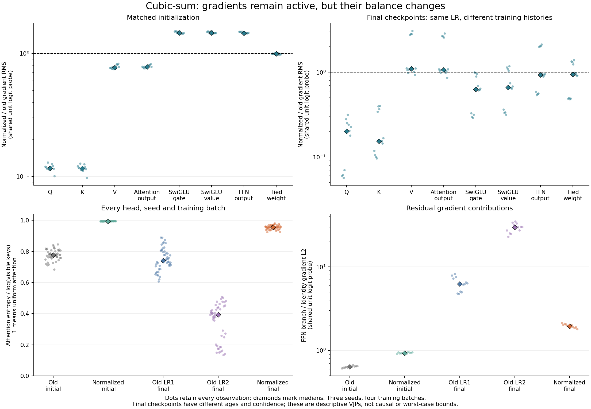

# Existing-model gradient paths on cubic-sum

The user requested a diagnosis before considering larger models. The
[plan](plan.json) freezes arithmetic-sum-cube, all three seeds, four fixed
64-example training batches, and the existing initial/final model states.
The original baseline passes 3/3, original LR×2 passes 1/3, and the normalized
inverse-width LR×2 model passes 0/3. Both original rates are retained to expose
the learning-rate confound. All models have the existing one layer, width 128,
four heads, fixed RoPE, Q/K RMS and tied embedding/readout weights.

Observe every executed module and the functional attention/SwiGLU operations.
Measure actual task-loss gradients and a shared unit logit-probe VJP separately:
small training-loss gradients alone cannot diagnose a blocked gradient path.
Reconstruct residual identity/branch gradient contributions and the tied
lookup/readout gradient contributions. Instrumentation must preserve each
forward and every parameter gradient against an uninstrumented execution.

This is a retrospective description on training examples, with no optimizer
updates, new held-out scores, benchmark promotion, or larger-model training.
The saved final checkpoints have different training ages and confidence levels.
The observations cannot establish a causal explanation of their trajectories,
a worst-case Jacobian bound, or suitability at larger scale. Historical failures
and the ten unresolved numerical stress failures remain recorded.

All **60 state/batch measurements and 120 objective backward passes** are complete.
Every observed forward and every unique parameter gradient exactly matches its
uninstrumented CPU reference. All **360 residual/tied-weight decompositions**
reconstruct with zero recorded error. All gradients and unmasked activations are
finite. The original graph exposes 56 observed sites; the normalized graph exposes
62, including its three additional RMS operations. The five independent checks
and initial failed validation attempts are retained in `results/`.

The most pronounced difference at **identical initial parameters** is reduced
Q/K sensitivity under the shared unit logit probe. Median paired normalized/old
parameter-gradient RMS ratios are **0.11665 for Q, 0.11616 for K, and 0.76735 for V**.
Raw embedding-output gradient RMS is nearly unchanged: median 0.10239 for the old
model and 0.10152 for the normalized model. Thus these observations show an active
input gradient path with a different distribution of sensitivity across components.

| Final checkpoint metric, unit probe | Original LR1 | Original LR2 | Normalized LR2 |
|---|---:|---:|---:|
| Attention entropy / log(visible keys) | 0.7404 | 0.3938 | 0.9555 |
| Raw embedding-output gradient RMS | 0.5982 | 0.5259 | 0.4663 |
| Attention branch / identity gradient L2 | 0.4113 | 0.2306 | 0.4696 |
| Feedforward branch / identity gradient L2 | 6.2520 | 29.7689 | 1.9540 |

These are medians across all three seeds and four fixed training batches;
attention additionally retains every head. Entropy one means uniform attention.
Against the paired original-LR2 final states, the normalized model's Q/K gradient
ratios have medians 0.2010/0.1531, while its V ratio is 1.0975. The checkpoints
have different ages, weights and outcomes, so these final-state comparisons do
not isolate the cause of learning failure. The old LR2 model also misses two
seeds despite its larger feedforward contribution: larger gradients alone do
not establish better generalization.

The task-loss and unit-probe results are separate. The successful original-LR1
checkpoints have a median training-batch loss about 3.17e-8 and tiny loss gradients,
while their unit-probe gradients remain substantial. Reading loss-gradient size
alone as a gradient-path failure would therefore give a misleading diagnosis.

The [complete measurements](results/measurements.json) retain every activation,
gradient, normalization pullback and checkpoint reference. The
[component CSV](results/components.csv), [parameter CSV](results/parameters.csv),
[residual paths](results/residual-paths.csv), [tied-weight paths](results/tied-weight-paths.csv),
[attention rows](results/attention.csv), and [paired unit-probe ratios](results/paired-unit-probe-gradients.csv)
retain all observations. The [summary](results/summary.json) includes individual
seed summaries and the full-grid audit; [figure provenance](results/figure.json)
pins the plotted inputs and outputs. No historical miss or numerical stress
failure is repaired by this descriptive result.

The original-model ablation study is separately closed with inverse-width retained.
The user has now explicitly authorized the next capacity experiment on cubic-sum:
depth alone, width alone, and both together, after this diagnostic. That prospective
experiment will keep head width fixed and preserve the existing benchmark selection.
